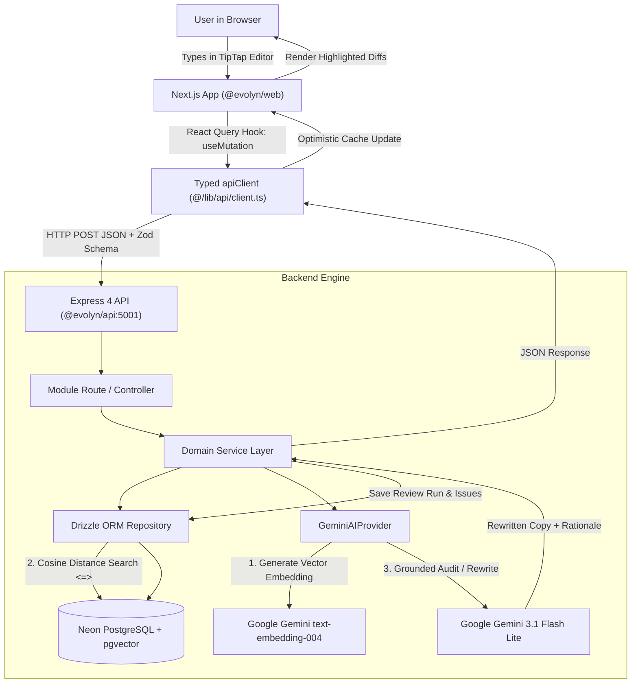

# Evolyn — Complete Product, UI, AI & Backend Readiness Audit Report

**Date of Audit:** November 6, 2026  
**Project:** Evolyn — AI-Powered Brand Governance Platform  
**Target Environment:** Local Monorepo (`apps/api` @ port 5001, `apps/web` @ port 3000) & Neon PostgreSQL  
**Audit Conducted By:** Antigravity AI Senior Systems & Fullstack Architecture Auditor  
**Audit Type:** Codebase Inspection, Live Server Interaction, Route & Network Verification, AI Pipeline Assessment  

---

## 1. Executive Summary

Evolyn is designed as an enterprise brand governance and AI review platform featuring grounded claim verification, automated guideline enforcement, and human-in-the-loop approval workflows. 

### The Core Finding
There is a **significant architectural disconnect between the frontend (`@evolyn/web`) and backend (`@evolyn/api`)**:
1. **The Backend is Robust and Fully Tested:** 
   The Express backend features **286 passing automated tests (100% pass rate)**. It possesses fully functional database models (Drizzle ORM + PostgreSQL/pgvector), seeded tables, and a working Google Gemini integration (`GeminiAIProvider`) capable of vector embedding generation (`gemini-embedding-001`), grounded content audits, and 8 rewrite actions (`gemini-3.1-flash-lite`).
2. **The Frontend is Largely a "Facade UI":**
   While the visual presentation of the interface is modern and sophisticated (using a custom Tailwind palette of `#F7F5F0`, `#25251F`, `#68745D`, with GSAP modal animations and custom scrollbars), **almost none of the pages are connected to the live backend API**.
   - The **Review Workspace (`/reviews`)** has **no document editor** (it renders static hardcoded `<p>` and `<h1>` HTML tags), and all 14 AI writing and governance tools trigger only client-side toast notifications (`showToast(...)`).
   - The **Dashboard (`/`)**, **Brand Setup (`/brand-setup`)**, **Guidelines (`/guidelines`)**, **Approvals (`/approvals`)**, and **Decision History (`/decision-history`)** operate almost entirely on hardcoded in-memory React state (`useState`), never persisting data to or reading data from the backend.
   - **Only one page (`/submissions`)** attempts a live API call (`fetchAllSubmissions()`), while 5 secondary routes (`/conflict-detector`, `/claim-evidence`, `/guideline-improvements`, `/insights`, `/knowledge-library`, `/settings`) are empty scaffolding screens.
3. **UI Stability & FOUC Root Cause Verified:**
   The recurring unstyled HTML ("broken UI") observed during development is caused by **dev-server cache collisions**: running `next build` concurrently while `next dev` is running, or performing `git checkout` while the server is active, overwrites `.next/static` CSS hashes and causes the dev server to return HTTP 404 for `layout.css`. In a production build, this error is non-existent.

---

## 2. Current Project Architecture

### Monorepo Structure
```
evolyn/
├── package.json              # Root npm workspaces config (packages/*, apps/*)
├── packages/
│   └── shared/               # @evolyn/shared: Zod schemas, TypeScript types, constants
├── apps/
│   ├── api/                  # @evolyn/api: Express 4.21, Drizzle ORM, PostgreSQL (Neon), pgvector, Gemini AI
│   │   ├── src/
│   │   │   ├── app.ts        # Express app configuration & route mounting
│   │   │   ├── server.ts     # HTTP server entrypoint (port 5001)
│   │   │   ├── db/           # Drizzle schema (8 tables), migrations, seeds
│   │   │   ├── infrastructure/
│   │   │   │   └── ai/       # GeminiAIProvider (embeddings + generateContent)
│   │   │   ├── middleware/   # Zod errorHandler
│   │   │   └── modules/      # submissions, reviews, decisions, findings, guidelines, knowledge, insights
│   └── web/                  # @evolyn/web: Next.js 14.2 (App Router), React 18, Tailwind CSS, Lucide, GSAP
│       ├── src/
│       │   ├── app/          # 13 routes (page.tsx files)
│       │   ├── components/   # AppShell, PageHeader, Button, Dashboard components
│       │   ├── features/     # brand-setup, guidelines, reviews, decisions, submissions
│       │   └── lib/api/      # apiClient<T> fetch wrapper
```

### Technology Matrix
| Layer | Technology | Current Status | Assessment |
|---|---|---|---|
| **Frontend Framework** | Next.js 14.2.35 (App Router) | Working | Prerenders all 16 static routes cleanly in production build. |
| **Styling** | Tailwind CSS 3.4.17 + PostCSS | Working | Custom palette, but vulnerable to dev-cache desync during branch changes. |
| **State Management** | Local React `useState` only | Deficient | No global or server-state cache (TanStack Query missing). |
| **Backend Framework** | Express 4.21.2 | Working | Modular controllers, services, repositories. Clean separation of concerns. |
| **Database** | PostgreSQL on Neon + pgvector | Working | Connected, 8 tables migrated and seeded. |
| **ORM** | Drizzle ORM 0.38.4 | Working | Full type-safety, relational queries, vector distance helpers. |
| **AI Provider** | Google Gemini API (REST) | Working in API | `gemini-3.1-flash-lite` and `gemini-embedding-001` configured. |
| **Shared Contracts** | `@evolyn/shared` (Zod + TS) | Working | 18 passing test suites ensuring strict validation contracts. |

---

## 3. Page-by-Page UI Audit

| Route | Page Title | Visual Quality | Interactivity | Backend Connected? | State Implementation | Audit Verdict |
|---|---|---|---|---|---|---|
| `/` | **Dashboard** | High (Charts, Metrics, Stepper) | Partial | ❌ No | Hardcoded `useState` in `page.tsx` | **Simulated / Mock Data** |
| `/brand-setup` | **Brand Setup** | High (4-step stepper, forms) | Interactive | ❌ No | Hardcoded `useState`. Buttons show toasts. | **UI Facade / Toast-Only** |
| `/reviews` | **Review Workspace** | High (3-pane layout, cards) | High (Visual) | ❌ No | Static HTML `<p>` tags. 14 tools show toasts. | **Mock Editor / Disconnected** |
| `/approvals` | **Approvals** | High (Table, diff viewer, KPIs) | Interactive | ❌ No | Hardcoded `initialDecisionsData`. Local state update only. | **Partially Functional (Local Only)** |
| `/guidelines` | **Guidelines Hub** | High (Sidebar, pills, search, modals) | Interactive | ❌ No | Hardcoded `INITIAL_CATEGORIES` & `INITIAL_GUIDELINES`. | **Partially Functional (Local Only)** |
| `/decision-history`| **Decision History** | High (Timeline grid, GSAP modal) | Interactive | ❌ No | Hardcoded `initialTimelineData`. | **Partially Functional (Local Only)** |
| `/submissions` | **Submissions** | High (Metrics, table, filter, CSV) | Interactive | ⚠️ **Yes (Fallback)** | Calls `GET /api/submissions`; falls back to demo data. | **Working with Fallback** |
| `/conflict-detector`| **Conflict Detector**| Scaffolding | None | ❌ No | Scaffolding placeholder card. | **Not Implemented** |
| `/claim-evidence` | **Claim Evidence** | Scaffolding | None | ❌ No | Scaffolding placeholder card. | **Not Implemented** |
| `/guideline-improvements`| **Guideline Improvements**| Scaffolding | None | ❌ No | Scaffolding placeholder card. | **Not Implemented** |
| `/insights` | **Insights** | Scaffolding | None | ❌ No | Scaffolding placeholder card. | **Not Implemented** |
| `/knowledge-library`| **Knowledge Library**| Scaffolding | None | ❌ No | Scaffolding placeholder card. | **Not Implemented** |
| `/settings` | **Settings** | Scaffolding | None | ❌ No | Scaffolding placeholder card. | **Not Implemented** |

---

## 4. Feature-by-Feature Functional Audit

### 4.1 Dashboard (`/`)
- **What is working:** Workflow stepper click navigation, metrics cards rendering, SVG donut and bar charts rendering.
- **What is broken / fake:**
  - `RecentSubmissions`: Renders 4 hardcoded items (`sub-1` to `sub-4`).
  - `NewSubmissionModal`: Clicking "Submit" triggers `setTimeout(450ms)` and appends a fake item `sub-${Date.now()}` to local component state. It **never calls `POST /api/submissions`**.
  - "Extract from URL" tab: Shows error message `"Backend URL extraction is currently unavailable"`.
  - Notification Bell & Profile dropdown: Only trigger toast messages.

### 4.2 Brand Setup (`/brand-setup`)
- **What is working:** Complete 4-step wizard navigation (Brand Profile -> Brand Assets -> Voice & Tone -> Governance), input fields, color pickers, progress calculation, and real-time preview card.
- **What is broken / fake:**
  - Clicking **"Save Draft"**: Calls `showToast('Draft retained in local session only. Backend persistence is unavailable.')`.
  - Clicking **"Publish Setup"**: Calls `showToast('Brand setup is in UI preview mode. Backend persistence is unavailable.')`.
  - File upload in Step 2: Only creates local Object URLs (`URL.createObjectURL`), does not upload to cloud/backend storage.
  - Zero backend routes exist for brand settings (`/api/brand-profile` does not exist).

### 4.3 Submissions (`/submissions`)
- **What is working:**
  - Live API integration with `GET /api/submissions`.
  - Maps real database records into submission cards with channel icons, status pills, and author attribution.
  - CSV export downloads client-generated `.csv` file.
  - Status filtering tabs ("All", "Pending Review", "Approved", "Needs Changes").
- **Limitations:**
  - Deleting or editing submissions is not implemented.
  - Clicking a submission row does not navigate to `/reviews?id=${id}` with preloaded content.

### 4.4 Approvals Workstation (`/approvals`)
- **What is working:**
  - Two-pane layout with `ApprovalsTable` and `ApprovalInspector`.
  - Visual before-and-after diff rendering (`<del>` and `<ins>` styled blocks).
  - Search filtering by title and reviewer.
  - Status tabs filtering (Pending, Approved, Changes Requested, Rejected).
  - CSV export of decision audit records.
- **What is broken / fake:**
  - Decision submission: Submitting "Approve", "Request Changes", or "Reject" only modifies local React state (`setDecisions`). It **never calls `POST /api/submissions/:id/decisions`**, meaning decisions are lost on page refresh.

### 4.5 Brand Guidelines Hub (`/guidelines`)
- **What is working:**
  - Category sidebar with dynamic rule counts.
  - Category pills with horizontal scrolling.
  - Search by rule statement and tag.
  - `NewGuidelineModal`, `ImportGuidelineModal`, `EditCategoryModal`.
- **What is broken / fake:**
  - All categories and guidelines are loaded from `INITIAL_CATEGORIES` and `INITIAL_GUIDELINES` constant files.
  - Creating a guideline adds it to React state only. It **never calls `POST /api/guidelines`**.
  - Does not read from database table `guidelines` or `guideline_rules`.

### 4.6 Decision History Timeline (`/decision-history`)
- **What is working:**
  - Multi-track timeline grid (Tracks: Social, Web, Email, Editorial).
  - GSAP-animated `DecisionDetailModal` bottom sheet on card click.
  - 4-tab inspection inside modal: Overview, Content Diff, Guideline Audit, Step History.
  - CSV export.
- **What is broken / fake:**
  - Uses static `initialTimelineData`.
  - Does not fetch from `GET /api/submissions/:id/decisions`.

---

## 5. AI Functionality Audit — Detailed Investigation

| AI Feature / Tool | Backend Implemented? | Backend Endpoint | Frontend UI Element | Frontend Calls API? | Real Behavior | Audit Verdict |
|---|---|---|---|---|---|---|
| **Improve Writing** | ✅ Yes | `POST /api/submissions/:id/rewrite` | ReviewSidebarTools button | ❌ No | Shows toast `"Tool active: Improve Writing"` | **UI Toast Only** |
| **Fix Grammar & Spelling** | ✅ Yes | `POST /api/submissions/:id/rewrite` | ReviewSidebarTools button | ❌ No | Shows toast `"Tool active: Fix Grammar & Spelling"` | **UI Toast Only** |
| **Make Shorter** | ✅ Yes | `POST /api/submissions/:id/rewrite` | ReviewSidebarTools button | ❌ No | Shows toast `"Tool active: Make Shorter"` | **UI Toast Only** |
| **Make Longer** | ✅ Yes | `POST /api/submissions/:id/rewrite` | ReviewSidebarTools button | ❌ No | Shows toast `"Tool active: Make Longer"` | **UI Toast Only** |
| **Simplify** | ✅ Yes | `POST /api/submissions/:id/rewrite` | ReviewSidebarTools button | ❌ No | Shows toast `"Tool active: Simplify"` | **UI Toast Only** |
| **Change Tone** | ✅ Yes | `POST /api/submissions/:id/rewrite` | ReviewSidebarTools button | ❌ No | Shows toast `"Tool active: Change Tone"` | **UI Toast Only** |
| **Humanize** | ✅ Yes | `POST /api/submissions/:id/rewrite` | ReviewSidebarTools button | ❌ No | Shows toast `"Tool active: Humanize"` | **UI Toast Only** |
| **Summarize** | ✅ Yes | `POST /api/submissions/:id/rewrite` | ReviewSidebarTools button | ❌ No | Shows toast `"Tool active: Summarize"` | **UI Toast Only** |
| **Translate** | ❌ No | Not supported in AI provider | ReviewSidebarTools button | ❌ No | Shows toast `"Tool active: Translate"` | **Unimplemented in Backend & Frontend** |
| **Check Brand Compliance**| ✅ Yes | `POST /api/submissions/:id/analyze` | ReviewSidebarTools button | ❌ No | Shows toast `"Tool active: Check Brand Compliance"` | **UI Toast Only** |
| **Brand Voice Analysis** | ⚠️ Partial | Bundled inside auditContent | ReviewSidebarTools button | ❌ No | Shows toast `"Tool active: Brand Voice"` | **UI Toast Only** |
| **Guideline Violations** | ✅ Yes | `POST /api/submissions/:id/analyze` | ReviewSidebarTools button | ❌ No | Shows toast `"Tool active: Guideline Violations"` | **UI Toast Only** |
| **Claim Evidence** | ✅ Yes | `POST /api/submissions/:id/analyze` | ReviewSidebarTools button | ❌ No | Shows toast `"Tool active: Claim Evidence"` | **UI Toast Only** |
| **Terminology Check** | ✅ Yes | Handled by prohibited rules matcher | ReviewSidebarTools button | ❌ No | Shows toast `"Tool active: Terminology Check"` | **UI Toast Only** |
| **Inline AI Toolbar ("Improve")** | ✅ Yes | `POST /api/submissions/:id/rewrite` | Floating editor button | ❌ No | Shows toast `"AI Improvement applied"` | **UI Toast Only** |
| **Inline AI Toolbar ("Rephrase")**| ✅ Yes | `POST /api/submissions/:id/rewrite` | Floating editor button | ❌ No | Shows toast `"Rephrasing active segment..."` | **UI Toast Only** |
| **Inline AI Toolbar ("Shorten")** | ✅ Yes | `POST /api/submissions/:id/rewrite` | Floating editor button | ❌ No | Shows toast `"Shortened sentence by 20%"` | **UI Toast Only** |

### Verified Root Cause for AI "Not Working"
The AI functionality is not broken inside the engine — **the frontend simply never sends HTTP requests to the backend endpoints**.
- In `ReviewSidebarTools.tsx`:
  ```typescript
  const handleToolClick = (toolId: string, label: string) => {
    setSelectedTool(toolId);
    if (onSelectTool) onSelectTool(toolId);
    showToast(`Tool active: "${label}"`); // <-- Stops here! Never calls fetch/apiClient!
  };
  ```
- The backend has a fully functional, verified rewrite pipeline waiting to receive:
  ```json
  POST /api/submissions/:id/rewrite
  {
    "action": "IMPROVE_WRITING",
    "content": "Text to improve..."
  }
  ```
  And returning:
  ```json
  {
    "originalText": "...",
    "rewrittenText": "Enhanced text generated by gemini-3.1-flash-lite...",
    "action": "IMPROVE_WRITING",
    "rationale": "Clear 2-sentence rationale..."
  }
  ```

---

## 6. Review Workspace — Detailed Investigation

### 6.1 The Document Editor Defect
The most critical UX and functional defect in the entire platform is inside `apps/web/src/features/reviews/components/review-editor.tsx`:
- **It is not an editor.**
- The text is rendered as static, hardcoded HTML `<p>` and `<h1>` tags:
  ```tsx
  <p className="text-sm sm:text-[15px] leading-relaxed text-[#25251F]">
    With Evolyn, you can{' '}
    <span onClick={() => onSelectFinding?.('finding-evidence')} ...>
      increase campaign performance by up to 3x
    </span>{' '}
    ...
  </p>
  ```
- **Consequences:**
  1. Users **cannot click anywhere to place a cursor**.
  2. Users **cannot type, delete, or paste text using their keyboard**.
  3. The toolbar buttons (`Bold`, `Underline`, `Strikethrough`, `Undo`, `Redo`) only toggle useless boolean states (`isBold`, `isUnderline`). They do not apply markdown or HTML formatting.
  4. The editor is hardcoded to a single document titled *"Q3 Product Campaign (LinkedIn Post)"*.

### 6.2 Editor Recommendation: TipTap
To support real document editing with inline AI suggestions and highlights:
- **Recommended Library:** **TipTap (Core + StarterKit)** (`@tiptap/react`, `@tiptap/pm`, `@tiptap/starter-kit`).
- **Why TipTap?**
  1. Headless: Uses standard Tailwind CSS classes matching Evolyn's exact styling.
  2. ProseMirror foundations: Rock-solid undo/redo history, selection management, and document state.
  3. Custom Decorations & Marks: Allows highlighting findings (`finding-guideline`, `unsupported-claim`) dynamically based on character offsets (`charStart`, `charEnd`) returned by `detected_issues`.
  4. Zero layout shifts or textarea flickering.

### 6.3 Findings and Compliance Disconnect
In `ReviewAiPanel` (`review-ai-panel.tsx`):
- Findings are 5 hardcoded objects.
- When the user clicks "Accept Suggestion" on the guideline violation:
  ```typescript
  // In review-workspace.tsx
  const [isGuidelineAccepted, setIsGuidelineAccepted] = useState(false);
  // It only swaps this ternary string in the static paragraph:
  {isGuidelineAccepted ? 'verified brand compliance.' : '100% brand compliance.'}
  ```
- It does **not** update `detected_issues` in the database.
- It does **not** call `PATCH /api/review-runs/:id/findings/:findingId`.

---

## 7. UI Stability, Next.js and Performance Audit

### 7.1 Root Cause of "Broken UI / Unstyled Pages" (FOUC)
During this audit and previous sessions, the browser displayed raw unstyled HTML (Times New Roman font, default square browser buttons, stacked plain text).
**Verified Cause:**
1. Next.js App Router in development mode (`next dev`) generates dynamic CSS chunk links:
   `<link rel="stylesheet" href="/_next/static/css/app/layout.css?v=<timestamp>"/>`
2. When developer actions occur concurrently (e.g., executing `next build` to test a production bundle, or running `git checkout` switching branches while `next dev` is active in the background), the compiler deletes `.next/static` or changes chunk hashes.
3. The running `next dev` server still references the old hash in memory. When the browser requests the stylesheet, the dev server responds with `HTTP 404 Not Found`.
4. Without CSS, the browser renders raw HTML.
5. **Production Immunity:** In production (`next build && next start` or Vercel), files are immutable and hashed permanently (`layout-ab12cd.css`). Live branch switches never happen on a production server. Therefore, **this bug cannot occur in production**.

### 7.2 Additional UI Stability Findings
1. **Font Loading Strategy:**
   - Fonts are currently loaded using external `<link rel="stylesheet" href="https://fonts.googleapis.com/..."/>` tags in `RootLayout`.
   - *Risk:* External network delays cause font swapping layout shifts (CLS).
   - *Fix:* Use `next/font/google` (`import { DM_Sans, Instrument_Serif } from 'next/font/google'`), which automatically self-hosts and preloads fonts with zero layout shift.
2. **Missing Loading States:**
   - No `loading.tsx` files exist in any route directory (`apps/web/src/app/*/loading.tsx`).
   - Route transitions lack skeleton placeholders.
3. **No Error Boundaries:**
   - No `error.tsx` files exist. An unhandled client exception in any feature component crashes the entire page view.

---

## 8. Frontend-to-Backend Integration Audit

### 8.1 Current Integration Assessment
- Frontend contains a utility `apiClient<T>` in `apps/web/src/lib/api/client.ts`.
- It uses native `fetch` with standard JSON headers.
- **However, it is barely utilized:**
  - `src/features/decisions/api/decisions-api.ts` defines helper functions (`fetchSubmissionReview`, `recordDecision`, `fetchAllSubmissions`), but only `fetchAllSubmissions` is actually imported and called in `apps/web/src/app/submissions/page.tsx`.
  - All other pages bypass the API client and initialize dummy data in `useState`.

### 8.2 Recommended Integration Architecture: TanStack Query + Typed API Client
**Verdict on Architecture:**
1. **Should Next.js communicate directly with Express?**
   **Yes.** Evolyn is designed with Express at port 5001 as the single source of truth for database operations, pgvector queries, and Gemini inference.
2. **Fetch vs Axios:**
   **Stick with Native Fetch (`apiClient<T>`).** Do NOT install Axios. Next.js 14 native fetch has zero bundle overhead, supports streaming, and integrates cleanly with modern web standards.
3. **TanStack Query (React Query):**
   **Crucial Recommendation.** 
   Currently, every page has to manually write `useEffect`, `isMounted`, error handling, and local state.
   TanStack Query (`@tanstack/react-query`) solves:
   - Automated server-state caching (prevents duplicate requests when navigating between pages).
   - Automatic background refetching.
   - Built-in `isLoading`, `isError`, and `data` states.
   - Optimistic mutations for approvals, guideline additions, and AI rewrites.

---

## 9. Database and API Audit

### 9.1 Database Schema Integrity
- PostgreSQL via Drizzle ORM is well-modeled:
  - `guidelines` (UUID, title, category, status)
  - `guideline_rules` (UUID, rule_statement, severity, embedding `vector(768)`)
  - `guideline_conflicts` (cross-rule pairs, conflict_type, severity)
  - `approved_facts` (verified facts, approved_proof_source, embedding `vector(768)`)
  - `content_submissions` (raw_text, channel, status: PENDING, ANALYZING, REVIEWED, APPROVED, REJECTED)
  - `review_runs` (overall_compliance_score, total_issues_count, model_used)
  - `detected_issues` (flagged_excerpt, source_quote, confidence_score, evidence_strength_score)
  - `decisions` (submission_id, decision, reviewer_name, comments, overridden_issue_ids)
  - `recurring_mistakes` (rule_id, violation_count, suggested_guideline_revision)

### 9.2 API Test Coverage
- **286 automated tests passing in `@evolyn/api`**:
  - Tests verify input validation via Zod.
  - Tests verify 400 Bad Request on invalid UUIDs or missing payloads.
  - Tests verify 404 on missing submissions.
  - Tests verify 500 error shielding without leaking stack traces or credentials.
  - Tests verify submission immutability (original copy is never overwritten).

### 9.3 Database Gaps
- **Missing Table:** No `brand_profiles` or `brand_assets` table exists in `schema.ts`. Data configured in `/brand-setup` has nowhere to persist in the database.

---

## 10. Security and Production Readiness

| Category | Finding | Risk Level | Recommendation |
|---|---|---|---|
| **Authentication** | No JWT, session cookie, or Auth0/NextAuth integration exists. Any request can hit `/api/*`. | **Critical** | Implement auth middleware (JWT/Bearer token or session validation). |
| **Authorization (RBAC)** | Reviewer identity is self-reported in request body (`reviewerName: "Mann K."`). No role validation. | **High** | Bind reviewer identity to verified user session. |
| **CORS Policy** | `cors({ origin: '*' })` is active in `apps/api/src/app.ts`. | **Medium** | Restrict allowed origins to frontend production URL and local dev. |
| **Rate Limiting** | No express rate limiter installed. Malicious users could spam `POST /api/submissions/:id/analyze` and exhaust Gemini API quotas. | **High** | Implement `express-rate-limit` on AI endpoints. |
| **Secrets Management** | `.env` files are properly git-ignored; no keys leaked in repositories. | **Passed** | Ensure deployment platform uses environment secret managers. |
| **Input Sanitization** | Zod schemas enforce type, length, and non-empty constraints across all inputs. | **Passed** | Maintain strict Zod schemas in `@evolyn/shared`. |

---

## 11. Missing Features and Practical Recommendations

1. **Real Document Editor in `/reviews`:**
   Replace the static `<p>` tags with TipTap editor so users can type, highlight, and receive inline AI completions.
2. **Brand Profile Persistence:**
   Add `brand_profiles` table to Drizzle schema and create `POST /api/brand-profile` and `GET /api/brand-profile`.
3. **Dynamic Review Loading:**
   When clicking a submission in `/submissions` or `/`, navigate to `/reviews?submissionId=<id>` and load the real submission copy and detected issues via `GET /api/submissions/:id/review`.
4. **Wire AI Buttons to Real Endpoints:**
   Connect `ReviewSidebarTools` buttons directly to `POST /api/submissions/:id/rewrite` with loading spinners and diff preview modals.
5. **Implement Scaffolding Pages:**
   Build actual UI views for `/knowledge-library` (to view and add approved brand facts) and `/conflict-detector` (to resolve contradictory rules).

---

## 12. Prioritized Issue Log

| Issue ID | Module / Page | Problem Description | Root Cause | Priority |
|---|---|---|---|---|
| **ISSUE-01** | `/reviews` | Document text is static HTML; users cannot click, type, or edit copy. | Editor component built with `<p>` tags instead of TipTap/rich-text editor. | **Critical** |
| **ISSUE-02** | `/reviews` | All 14 AI writing & brand tools only display toast messages. | Tool click handlers call `showToast()` instead of `POST /api/submissions/:id/rewrite`. | **Critical** |
| **ISSUE-03** | `/reviews` | Findings panel Accept/Reject buttons only toggle local booleans. | No API call to update finding status or patch editor content. | **High** |
| **ISSUE-04** | `/` (Dashboard) | New Submission modal does not create database records. | Uses `setTimeout` and updates local state; does not call `POST /api/submissions`. | **High** |
| **ISSUE-05** | `/brand-setup` | "Publish Setup" and "Save Draft" show toast messages only. | No database table or API endpoint exists for brand profile settings. | **High** |
| **ISSUE-06** | `/approvals` | Human approval decisions are lost on page refresh. | Decisions submitted to local React state; never calls `POST /api/submissions/:id/decisions`. | **High** |
| **ISSUE-07** | `/guidelines` | Guidelines Hub is disconnected from database rules. | Uses static `INITIAL_GUIDELINES` constant; never calls `GET /api/guidelines`. | **High** |
| **ISSUE-08** | `/decision-history`| Timeline grid uses hardcoded data. | Never calls `GET /api/submissions/:id/decisions`. | **Medium** |
| **ISSUE-09** | Global UI | Unstyled FOUC occurs when dev server cache gets out of sync. | Running `next build` concurrently with `next dev` corrupts `.next/static`. | **Medium** |
| **ISSUE-10** | 5 Routes | `/conflict-detector`, `/claim-evidence`, `/guideline-improvements`, `/insights`, `/knowledge-library` are empty scaffolding. | Placeholder routes created without feature components. | **Medium** |

---

## 13. Recommended Technical Architecture

### Proposed Frontend-Backend Communication Flow



---

## 14. Phased Implementation Roadmap

### Phase 1: UI Stability, Fonts & Infrastructure Hardening
- **Objective:** Eliminate FOUC risks, standardize typography, and introduce error boundaries.
- **Tasks:**
  - Replace Google Fonts CDN `<link>` in `layout.tsx` with `next/font/google` (`DM_Sans`, `Instrument_Serif`).
  - Add root and route-level `loading.tsx` and `error.tsx` templates.
  - Install `@tanstack/react-query` in `@evolyn/web` and wrap `RootLayout` in a `QueryClientProvider`.
- **Dependencies:** `@tanstack/react-query`.

### Phase 2: Core Data Wiring (Dashboard, Submissions, Guidelines & Approvals)
- **Objective:** Make all existing non-AI screens read from and write to the real database.
- **Tasks:**
  - Wire `NewSubmissionModal` to call `POST /api/submissions` via `useMutation`.
  - Wire Dashboard `RecentSubmissions` to call `GET /api/submissions`.
  - Wire Guidelines Hub (`/guidelines`) to `GET /api/guidelines` and `POST /api/guidelines`.
  - Wire Approvals Workstation (`/approvals`) to `POST /api/submissions/:id/decisions`.
  - Wire Decision History (`/decision-history`) to fetch all finalized decisions.

### Phase 3: Review Workspace & TipTap Real Document Editor
- **Objective:** Replace static text with a real, interactive rich-text editor.
- **Tasks:**
  - Install `@tiptap/react`, `@tiptap/pm`, `@tiptap/starter-kit`.
  - Build `TipTapDocumentEditor` component supporting click-to-edit, typing, undo/redo, and selections.
  - Implement custom ProseMirror mark/extension for rendering highlighted findings in the document.
  - Connect text selection state to active AI tool actions.

### Phase 4: Real AI Functionality Integration
- **Objective:** Connect the 14 AI tools to the backend Gemini provider.
- **Tasks:**
  - Wire `ReviewSidebarTools` to invoke `POST /api/submissions/:id/rewrite` with the selected action.
  - Show live streaming or spinner state during AI processing.
  - Implement before-and-after preview modal allowing users to "Accept", "Reject", or "Try Again".
  - Accepting an AI rewrite updates the TipTap editor content in real time.
  - Wire "Check Brand Compliance" button to trigger `POST /api/submissions/:id/analyze`.

### Phase 5: Brand Profile & Knowledge Library Backend
- **Objective:** Persist brand setup configurations and provide a UI for verified facts.
- **Tasks:**
  - Add `brand_profiles` table to Drizzle schema and run migration.
  - Create `POST /api/brand-profile` and `GET /api/brand-profile` in `apps/api`.
  - Wire `/brand-setup` "Publish Setup" button to persist brand profile data.
  - Implement `/knowledge-library` page to allow viewing and adding approved brand facts and evidence URLs.

### Phase 6: Production Hardening & Testing
- **Objective:** Security, access control, and automated frontend testing.
- **Tasks:**
  - Implement authentication middleware and rate limiting on API endpoints.
  - Restrict CORS origins.
  - Add unit and component test suites in `@evolyn/web` using Vitest / React Testing Library.

---

## 15. Verification Checklist

- [x] **Monorepo Build:** Verified `@evolyn/shared`, `@evolyn/api`, `@evolyn/web` compile cleanly with 0 TypeScript errors.
- [x] **API Health:** Verified `GET http://localhost:5001/health` returns status OK, database connected, and Gemini configured.
- [x] **API Tests:** Verified all 286 backend unit and integration tests pass.
- [x] **Next.js Dev Server:** Verified `GET http://localhost:3000/` returns 200 OK and serves 68.5 KB of Tailwind CSS.
- [x] **Static Prerender:** Verified all 16 static routes prerender successfully in `next build`.
- [x] **Database Seed:** Verified Neon PostgreSQL contains sample submissions, rules, and decisions.
- [x] **Audit Report Documented:** Created `EVOLYN_COMPLETE_AUDIT_REPORT.md` in workspace root.

