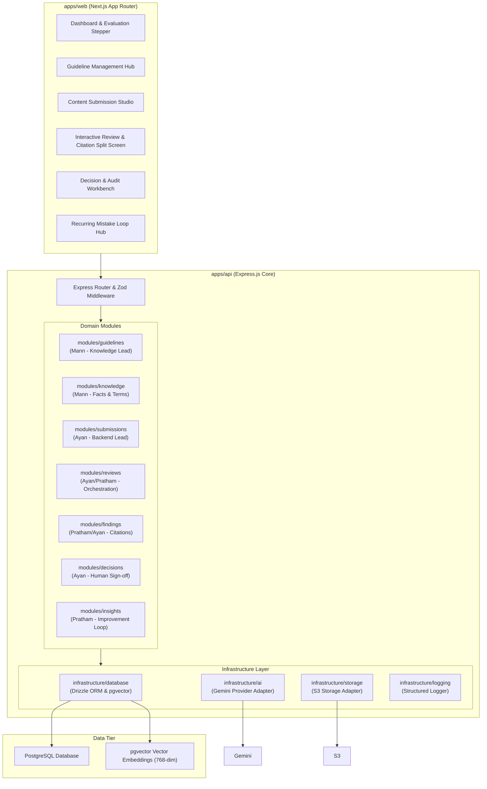
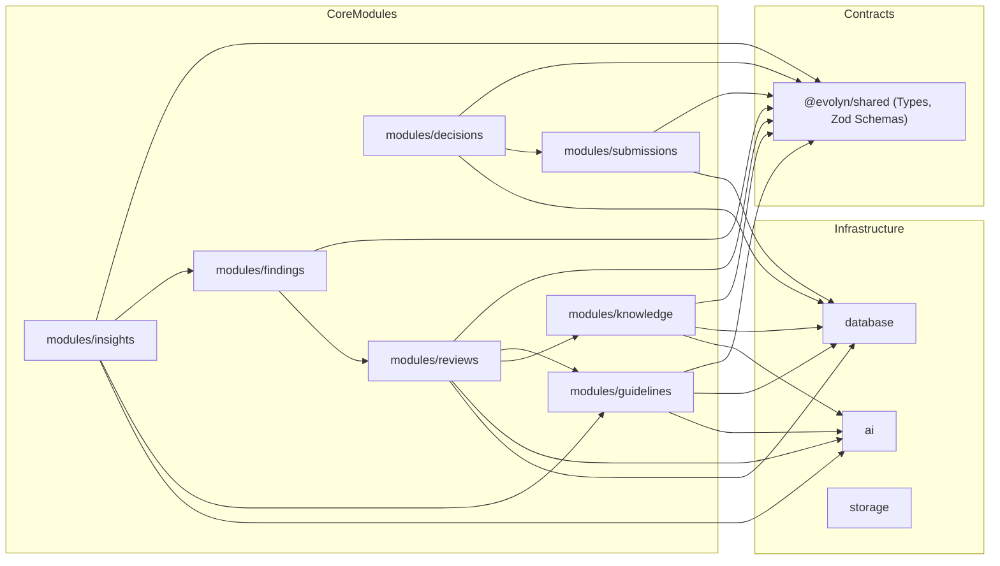

# Evolyn Architecture & System Blueprint

> **Team:** Matrix Mechanics
> **Platform:** Evolyn AI-Powered Brand Governance Platform
> **Event:** CodeNexus India 2026 (Round 2)
> **Status:** Phase 1 Foundation Active

---

## 1. System Philosophy & Objectives

Evolyn is designed as a **Modular Monolith** rather than a distributed set of microservices.

### Why Modular Monolith?
1. **Operational Simplicity:** Avoids network latency, service discovery overhead, distributed transaction complexity, and multi-repo synchronization friction during a hackathon build window.
2. **Clear Boundaries without Distributed Complexity:** Each domain module (`guidelines`, `knowledge`, `submissions`, `reviews`, `findings`, `decisions`, `insights`) maintains strict encapsulation:
   - Routes handle HTTP mapping and validation.
   - Controllers orchestrate operations.
   - Services execute domain business logic (independent of Express objects).
   - Repositories encapsulate Drizzle ORM queries and database interactions.
3. **Shared Contracts:** `@evolyn/shared` provides a single source of truth for TypeScript interfaces and Zod validation schemas, eliminating schema drift between backend and frontend.

---

## 2. High-Level System Context (C4 Level 1)

```mermaid
graph TD
    User["Content Creator / Marketer"]
    Judge["Reviewer / Judge / Brand Guardian"]

    subgraph EvolynSystem["Evolyn Brand Governance Platform"]
        Web["apps/web (Next.js 14 App Router)"]
        API["apps/api (Express.js Modular Monolith)"]
        DB[("PostgreSQL 16 + pgvector")]
    end

    Gemini["Google Gemini AI API\n(Flash 2.0 & text-embedding-004)"]
    S3["AWS S3 / S3-Compatible Storage"]

    User -->|Submits content for review| Web
    Judge -->|Manages guidelines, reviews findings, makes decisions| Web
    Web -->|REST API Calls (Zod validated)| API
    API -->|Persists rules, vectors, submissions, decisions| DB
    API -->|Vector embeddings & structured audits| Gemini
    API -->|Uploads guideline PDFs & assets| S3
```

---

## 3. Application Component Architecture (C4 Level 2)



---

## 4. Module Dependency Graph



### Module Boundary Enforcement Rules:
1. **No Circular Imports:** Dependency flows strictly from application routes down to domain services, repositories, and infrastructure.
2. **Repository Isolation:** Modules must not directly call another module's internal repository. Cross-module communication uses exported domain services or public interfaces.
3. **No Direct Express in Services:** Services take pure input data (DTOs) and return domain results or throw domain errors. HTTP codes are assigned in controllers/middleware.
4. **Validation at the Boundary:** Every incoming request is validated against Zod schemas in middleware before reaching any controller logic.
