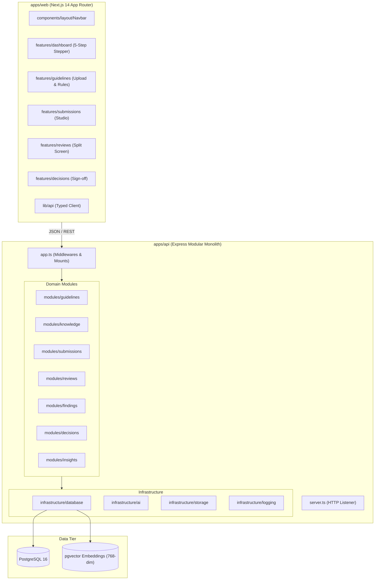

# Component Architecture

> **Platform:** Evolyn Brand Governance Platform
> **Architecture:** Modular Monolith with Next.js & Express

---

## 1. System Overview

---

## 2. Shared Contracts Layer (`@evolyn/shared`)
Both `apps/web` and `apps/api` import validation schemas and interfaces directly from `@evolyn/shared`. This guarantees:
- Frontend forms validate using the exact same Zod schemas as backend controllers.
- Backend API responses match the frontend's expected TypeScript types.
- Zero manual interface duplication across team boundaries.
