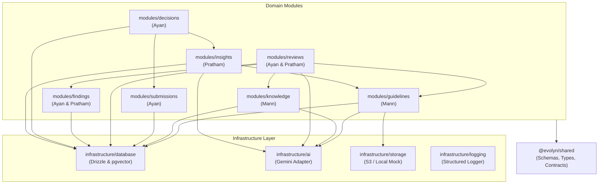

# Module Dependency Architecture

> **Team:** Matrix Mechanics | **Lead:** Pratham

---

## 1. Dependency Graph

---

## 2. Cross-Module Isolation Rules

1. **Strict Upward / Outward Boundary:**
   - Modules may depend on `infrastructure/` and `@evolyn/shared`.
   - Modules may call public service methods of other modules via their public interface (e.g. `IGuidelineService`).
   - Modules MUST NOT import private files, repositories, or internal schemas from another module.
2. **Zero Direct DB Modification:**
   - Each database table has an exclusive owner module.
   - Only `modules/submissions` writes to `content_submissions`.
   - Only `modules/guidelines` writes to `guidelines` and `guideline_rules`.
   - Only `modules/decisions` writes to `decisions`.
3. **No Express In Services:**
   - Domain services receive typed DTOs and return typed domain objects.
   - Express `Request` and `Response` objects never enter service functions.
