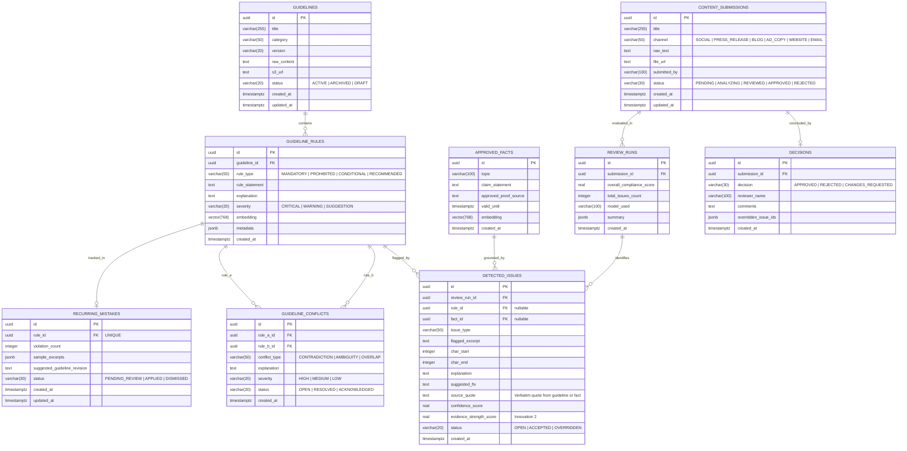

# Evolyn Database Schema & Entity Relationships

> **Database Engine:** PostgreSQL 16 with `pgvector` Extension
> **ORM & Migration Tool:** Drizzle ORM (`drizzle-orm`, `drizzle-kit`)
> **Vector Dimensions:** 768 (`text-embedding-004`)

---

## 1. Entity Relationship (ER) Diagram

---

## 2. Table Specifications, Constraints & Indexes

### 1. `guidelines`
* **Primary Key:** `id` (UUID, `gen_random_uuid()`)
* **Foreign Keys:** None
* **Indexes:**
  - `idx_guidelines_status` ON (`status`)
  - `idx_guidelines_category` ON (`category`)
* **Business Invariant:** A guideline must have raw text content before rules can be extracted.

### 2. `guideline_rules`
* **Primary Key:** `id` (UUID)
* **Foreign Keys:** `guideline_id` REFERENCES `guidelines(id)` ON DELETE CASCADE
* **Vector Index:** `embedding vector(768)`
* **Indexes:**
  - `idx_rules_guideline_id` ON (`guideline_id`)
  - `idx_rules_rule_type` ON (`rule_type`)
  - `idx_rules_severity` ON (`severity`)
* **Business Invariant:** Deleting a guideline automatically purges all child rules and their associated conflict entries.

### 3. `guideline_conflicts`
* **Primary Key:** `id` (UUID)
* **Foreign Keys:**
  - `rule_a_id` REFERENCES `guideline_rules(id)` ON DELETE CASCADE
  - `rule_b_id` REFERENCES `guideline_rules(id)` ON DELETE CASCADE
* **Indexes:**
  - `idx_conflicts_rule_a` ON (`rule_a_id`)
  - `idx_conflicts_rule_b` ON (`rule_b_id`)
  - `idx_conflicts_status` ON (`status`)

### 4. `approved_facts`
* **Primary Key:** `id` (UUID)
* **Vector Index:** `embedding vector(768)`
* **Indexes:**
  - `idx_facts_topic` ON (`topic`)
* **Business Invariant:** Every fact requires an explicit, audited `approved_proof_source`.

### 5. `content_submissions`
* **Primary Key:** `id` (UUID)
* **Indexes:**
  - `idx_submissions_status` ON (`status`)
  - `idx_submissions_created_at` ON (`created_at`)

### 6. `review_runs`
* **Primary Key:** `id` (UUID)
* **Foreign Keys:** `submission_id` REFERENCES `content_submissions(id)` ON DELETE CASCADE
* **Indexes:**
  - `idx_review_runs_submission_id` ON (`submission_id`)

### 7. `detected_issues`
* **Primary Key:** `id` (UUID)
* **Foreign Keys:**
  - `review_run_id` REFERENCES `review_runs(id)` ON DELETE CASCADE
  - `rule_id` REFERENCES `guideline_rules(id)` ON DELETE SET NULL
  - `fact_id` REFERENCES `approved_facts(id)` ON DELETE SET NULL
* **Indexes:**
  - `idx_detected_issues_review_run` ON (`review_run_id`)
  - `idx_detected_issues_rule_id` ON (`rule_id`)
  - `idx_detected_issues_status` ON (`status`)
* **Integrity Guard:** `source_quote` cannot be empty. Fabricated or empty citations are rejected at insertion time.

### 8. `decisions`
* **Primary Key:** `id` (UUID)
* **Foreign Keys:** `submission_id` REFERENCES `content_submissions(id)` ON DELETE CASCADE
* **Indexes:**
  - `idx_decisions_submission_id` ON (`submission_id`)
* **Invariant:** A decision records human reviewer sign-off with comments.

### 9. `recurring_mistakes`
* **Primary Key:** `id` (UUID)
* **Foreign Keys:** `rule_id` REFERENCES `guideline_rules(id)` ON DELETE CASCADE
* **Unique Constraint:** `rule_id` (one record per rule, tracking cumulative violations)
* **Indexes:**
  - `idx_recurring_mistakes_rule_id` (UNIQUE)
  - `idx_recurring_mistakes_count` ON (`violation_count`)
