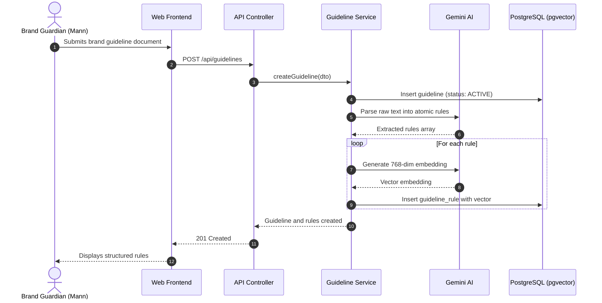
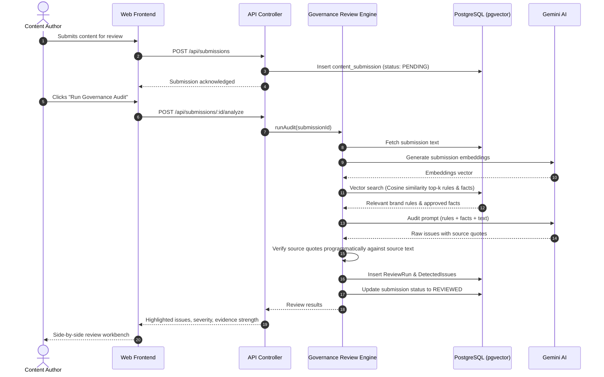
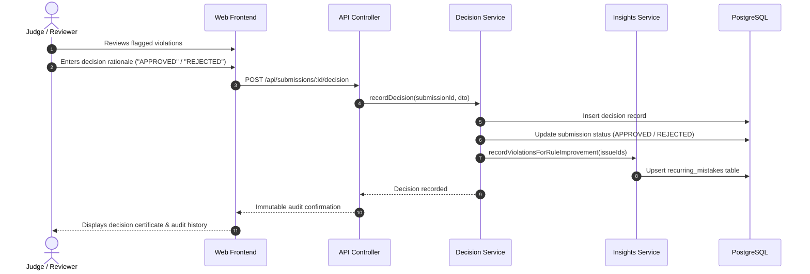

# Evolyn System Sequence Diagrams

> **System:** Evolyn AI Brand Governance Platform
> **Team:** Matrix Mechanics

---

## 1. Guideline Ingestion & Rule Embedding Flow

---

## 2. Content Submission & Multi-Layer Audit Flow

---

## 3. Human Approval Decision & Audit Trail Flow

