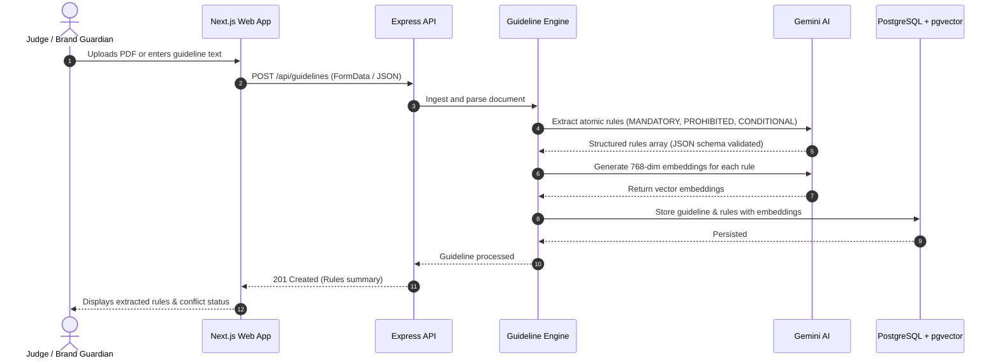
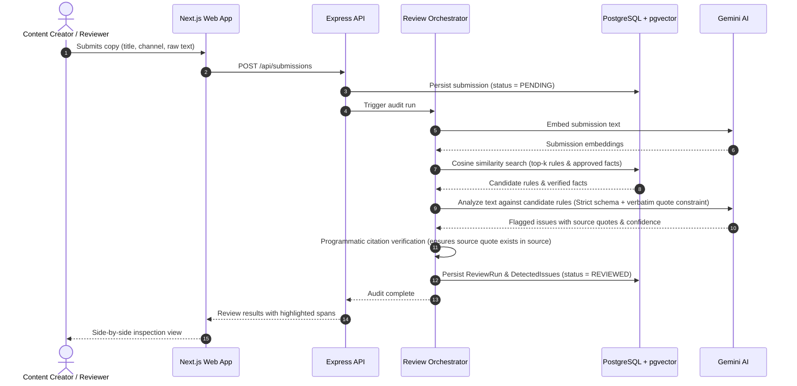
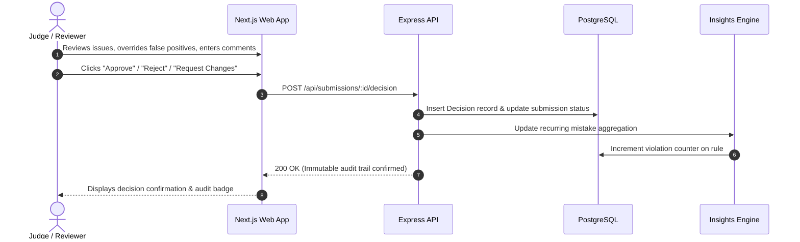

# Evolyn System Design

> **Team Matrix Mechanics** | CodeNexus India Round 2
> **System:** Evolyn AI-Powered Brand Governance Platform

---

## 1. Domain Problem & Scope

### The Problem
Enterprises and fast-moving brands generate thousands of customer-facing touchpoints (social campaigns, blog posts, sales decks, customer communications, ad copy). Maintaining brand compliance across these assets manually creates massive bottlenecks, while human reviewers frequently overlook:
- Subtle terminology violations (e.g., using outdated brand names or unapproved acronyms).
- Unsubstantiated or exaggerated metrics (e.g., "100% fail-proof", unverified customer counts).
- Regulatory liabilities (e.g., missing mandatory disclaimers, illegal performance guarantees).
- Conflicting guidelines created by different departments over time.

### The Solution: Evolyn
Evolyn provides automated, grounded brand governance:
1. **Verifiable Rule Matching:** Maps incoming copy directly against structured brand rules with vector similarity and strict citation checking.
2. **Factual Grounding:** Matches claims against verified corporate truth sources. If a fact cannot be cited verbatim from an approved source, it is flagged.
3. **Evidence-Driven Review:** Shows exact source quotations and an evidence strength gauge (0–100%).
4. **Mandatory Human Decision:** The AI advises; the human approves, rejects, or requests changes.
5. **Continuous Improvement Loop:** Overridden issues and recurring violations are analyzed to suggest revisions to ambiguous rules.

---

## 2. Core Workflows & Data Flows

### Workflow 1: Guideline & Knowledge Ingestion (Mann)

### Workflow 2: Content Submission & Governance Audit (Ayan & Pratham)

### Workflow 3: Human Decision & Feedback Recording (Ayan & Pratham Kave)

---

## 3. The Three Core Innovations Deep Dive

### Innovation 1: Guideline Conflict & Ambiguity Detector
* **Problem:** Brand guidelines written across different quarters or departments frequently contradict each other (e.g., Marketing: "Use bold conversational tone" vs Legal: "Always maintain strictly formal enterprise tone").
* **Mechanism:**
  1. When a new rule is ingested, pgvector queries existing rules within the same or overlapping categories using cosine similarity.
  2. Candidate pairs with high semantic overlap are evaluated by Gemini using a zero-shot logical contradiction prompt.
  3. Conflicts are categorized as `CONTRADICTION`, `AMBIGUITY`, or `OVERLAP` with an explanation and assigned severity.

### Innovation 2: Claim Evidence Strength Engine
* **Problem:** Marketing copy often includes claims with varying degrees of proof (e.g., "fastest in market" vs "45 enterprise customers" vs "100% uptime").
* **Mechanism:**
  1. The engine isolates numerical, performance, and comparative claims in submitted copy.
  2. It searches the `approved_facts` vector index for corroborating proof.
  3. The engine assigns an **Evidence Strength Score (0.0 to 1.0)** based on:
     - Exact metric alignment (Does the number match the approved fact?).
     - Citation specificity (Is an audited document name/page cited?).
     - Freshness (Is the approved fact still within its `valid_until` date?).
  4. Visualized in the UI as a color-coded confidence meter.

### Innovation 3: Recurring Mistake → Guideline Improvement Loop
* **Problem:** Human writers make the same mistakes repeatedly because guidelines are poorly phrased, buried in long PDFs, or ambiguous.
* **Mechanism:**
  1. Every human rejection or issue flag increments a counter in the `recurring_mistakes` table for the corresponding rule.
  2. When a rule crosses a threshold (e.g., 3+ violations), Gemini synthesizes the real-world sample excerpts into a proposed guideline refinement.
  3. The Brand Guardian can view suggested wording refinements (e.g., "Add concrete DO/DON'T example for Rule #4") and apply them with one click.
