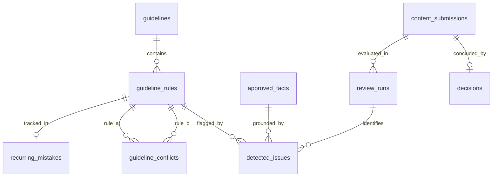

# Database Entity Relationship (ER) & Table Ownership

> **Engine:** PostgreSQL 16 with `pgvector`
> **ORM:** Drizzle ORM

---

## 1. Table Ownership Matrix

| Table Name | Owning Module | Responsible Engineer | Primary Key | Vector Columns |
| :--- | :--- | :--- | :--- | :--- |
| `guidelines` | `modules/guidelines` | Mann | `id (UUID)` | None |
| `guideline_rules` | `modules/guidelines` | Mann | `id (UUID)` | `embedding vector(768)` |
| `guideline_conflicts` | `modules/guidelines` | Mann | `id (UUID)` | None |
| `approved_facts` | `modules/knowledge` | Mann | `id (UUID)` | `embedding vector(768)` |
| `content_submissions` | `modules/submissions` | Ayan | `id (UUID)` | None |
| `review_runs` | `modules/reviews` | Ayan & Pratham | `id (UUID)` | None |
| `detected_issues` | `modules/findings` | Ayan & Pratham | `id (UUID)` | None |
| `decisions` | `modules/decisions` | Ayan | `id (UUID)` | None |
| `recurring_mistakes` | `modules/insights` | Pratham | `id (UUID)` | None |

---

## 2. Entity Relationship Diagram

